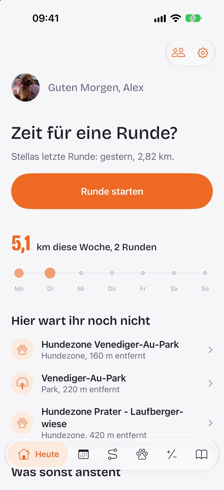
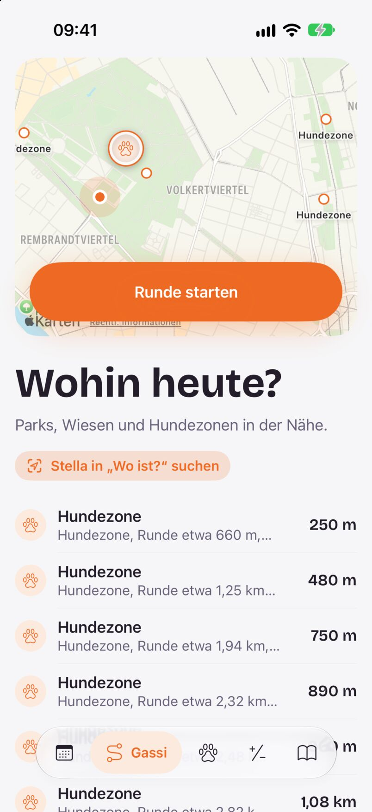
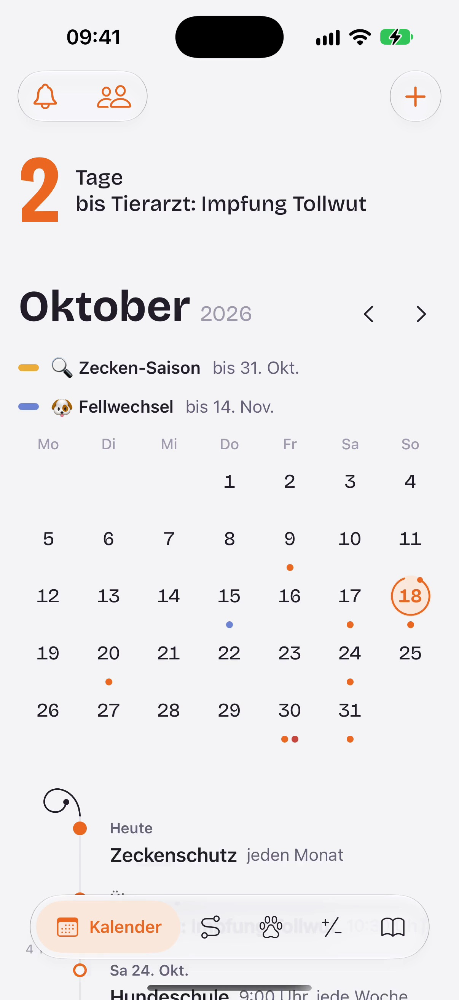
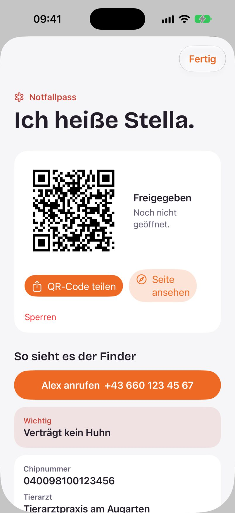

# ThisDog

**Die App für Menschen mit Hund – und für alle, die sich mit ihnen um ihn kümmern.**
Gassirunden, Gesundheit, Termine und Notfallpass an einem Ort, geteilt im Rudel und
Ende-zu-Ende-verschlüsselt. Für iPhone, iPad, Apple Watch und Android.

<p>




</p>

Website: [thisdog.app](https://thisdog.app)

> **English:** ThisDog is a dog-care app for iOS/watchOS (SwiftUI) and Android (Kotlin/Compose) with a small
> PHP/SQLite server. Walks with suggested destinations (parks, dog zones from OpenStreetMap), vaccinations,
> deworming, medication and appointments, a health diary, an emergency pass with QR code, a food check and
> guides. Several people share one dog as a *pack*; everything they sync is end-to-end encrypted — the server
> only stores ciphertext. The code and docs are in German; issues and pull requests in English are welcome.
> Licensed under Apache-2.0; the name, logo, icons and dog photos are excluded (see `THIRD-PARTY.md`).

## Was die App kann

- **Gassi:** Runden aufzeichnen (auch auf der Apple Watch, mit Live-Aktivität), Ziele in der Nähe finden –
  Parks, Wiesen, Hundezonen –, Orte bewerten und vor Ort einchecken.
- **Gesundheit:** Impfungen, Entwurmung, Medikamente, Gewicht und ein Tagebuch mit Fotos; Erinnerungen,
  wenn etwas fällig ist.
- **Kalender:** eigene Termine (auch über mehrere Tage), saisonale Hinweise wie Zeckenzeit oder Hitze.
- **Notfallpass:** ein QR-Code fürs Halsband; wer den Hund findet, sieht, wen er anrufen kann. Entlaufen
  melden mit einem Tipp.
- **Food-Check, Ratgeber, Rechner:** „Darf mein Hund das essen?“, Tipps und Futtermengen.
- **Rudel:** Besitzer und Hundesitter teilen sich alles; Rollen, Mitteilungen je Person, Einladung per Link
  oder QR-Code – ohne E-Mail und ohne Passwort.

## Datenschutz als Bauprinzip

Was ein Rudel abgleicht, verschlüsselt das Gerät, bevor es hinausgeht (AES-GCM, ein Schlüssel je Rudel).
Der Schlüssel reist nur hinter dem `#` eines Einladungslinks oder als Wiederherstellungsschlüssel und
erreicht den Server nie. Der Server kennt Konten, Mitgliedschaften und Zeitstempel, aber keine Inhalte.
Details und Codeverweise unter [Konto, Rudel und Verschlüsselung](#konto-rudel-und-verschlüsselung).

## Stand

ThisDog ist im Testbetrieb mit einer kleinen Gruppe. Die Apps sind noch nicht in den Stores. Rechnet mit
Änderungen am Datenformat und an der Schnittstelle.

## Mitmachen

Fehler und Ideen gern als Issue. Pull Requests bitte klein und mit Tests, wo es geht (`tests/` für den
Server, die Unit-Tests der Apps). Sicherheitslücken bitte **nicht** öffentlich melden, sondern wie in
[`SECURITY.md`](SECURITY.md) beschrieben.

## Lizenz

Apache-2.0 (`LICENSE`, `NOTICE`). Name, Logo, Icons und die Fotos des Hundes sind davon ausgenommen, ebenso
einige fremde und KI-erzeugte Inhalte – siehe [`THIRD-PARTY.md`](THIRD-PARTY.md). Wer eine eigene Fassung
veröffentlicht, gibt ihr bitte einen eigenen Namen und eigene Icons ([Eigene Fassung](#eigene-fassung)).

## Aufbau

- **iOS / iPadOS / watchOS**: SwiftUI, unter `ios/`
- **Android**: Kotlin und Jetpack Compose, unter `android/`
- **Server**: PHP mit SQLite, unter `public/` (Konten, Rudel, Abgleich, Notfallpass, Orte, Push)
- **Webseite**: unter `website/`, ausgeliefert als `public/index.html`

## Ordner

```
ios/            Xcode-Projekt als project.yml (xcodegen): App, Widgets, Mitteilungen, Watch, Tests
android/        Gradle-Projekt, App unter android/app
public/         Alles, was auf den Webserver kommt: api/ (PHP), data/ (Inhalte), Seiten, Medien
server/         Läuft auf dem Server, aber nicht im Web: OpenStreetMap-Import (server/LIESMICH.md)
tests/          Servertests gegen einen lokalen PHP-Server
website/        Quelle der Webseite (website/LIESMICH.md)
appstore/       Store-Texte und Bildschirmfotos (appstore/LIESMICH.md)
quellen/        Hilfsskripte (lokaler Router, Diagnose), Original-Bilder, Recherche
tools/i18n/     Prüfen und Vorlagen für Übersetzungen (LOKALISIERUNG.md)
```

Nicht im Repository und nie einzuchecken: `stella-daten/` (Konfiguration, Schlüssel, Datenbanken),
`ios/ThisDog.xcodeproj` (wird erzeugt), `ios/scripts/lokal.env`, `android/local.properties`.

## iOS und watchOS

Voraussetzungen: Xcode mit iOS-27-SDK, [xcodegen](https://github.com/yonaskolb/XcodeGen).
Mindestversion iOS/watchOS 27.0.

```sh
cd ios
xcodegen                                  # erzeugt ThisDog.xcodeproj aus project.yml
xcodebuild test -project ThisDog.xcodeproj -scheme ThisDog \
  -destination 'platform=iOS Simulator,name=iPhone Duo' -collect-test-diagnostics never
```

Ziele: `ThisDog` (App), `ThisDogWidgets` (Widgets, Live-Aktivität), `ThisDogNotifications`
(Mitteilungen aus dem Rudel), `ThisDogWatch` und `ThisDogWatchWidgets`; Unit-Tests in `ThisDogTests`,
das Schema `Aufnahmen` macht mit `ThisDogUITests` Bildschirmfotos. Gemeinsamer Code liegt in `Shared/`
und `SharedWidgets/`.

Startargumente der Entwicklerfassung, z. B. `-beispiel` (Beispieldaten), `-tab heute|kalender|gassi|hund|wissen`,
`-ratgeber`, `-rudel`, `-runde` (startet eine Runde), `-vorfuehrung`. Alle stehen in
`ios/ThisDog/App/ThisDogApp.swift`.

**Aufs eigene Gerät.** Zwei Skripte für Entwicklerfassungen außerhalb des App Store. Gerät,
Signaturidentität, Schlüsselbund und Server kommen aus `ios/scripts/lokal.env` (Vorlage
`lokal.env.beispiel`); fehlt ein Wert, brechen sie mit einer Meldung ab.

- `scripts/ipad-bauen.sh [--nur-bauen]`: baut, signiert mit dem Team-Profil (ohne Universal Links und
  Push) und installiert per `devicectl`.
- `scripts/ipad-link.sh [--entfernen]`: baut mit automatischer Signatur und legt IPA, Manifest und
  (falls gebaut) die Android-APK unter einer zufälligen Adresse auf dem eigenen Server ab, zum Laden über
  `itms-services`.

## Android

Voraussetzungen: JDK 21, Android SDK (Pfad in `android/local.properties` oder `ANDROID_HOME`).

```sh
cd android
./gradlew assembleDebug                   # app/build/outputs/apk/debug/
./gradlew testDebugUnitTest               # Unit-Tests unter app/src/test
```

minSdk 29, Paketname `app.thisdog`. Beispieldaten in Debug-Fassungen: Intent-Extra `beispiel=true`.
Die Release-Signatur liest ihre Werte aus `~/.thisdog/android-release.properties` außerhalb des
Repositorys (siehe `android/app/build.gradle.kts`). Icons entstehen mit
`python3 android/tools/icons_aus_svg.py` aus den SVGs der iOS-Fassung.

## Server

PHP 8 (entwickelt mit 8.5) mit `pdo_sqlite`, `curl`, `mbstring`, `openssl` und `gd`, dazu Apache mit
`mod_rewrite` (die Regeln stehen in `public/.htaccess`). Kein Build-Schritt, keine Bibliotheken.

### Einrichten

1. Den Inhalt von `public/` in den Webordner laden. Der Ordner darf jederzeit vollständig ersetzt werden;
   alles, was bleiben muss, liegt außerhalb.
2. `public/api/config.example.php` als `stella-daten/config.php` **neben** den Webordner kopieren und
   ausfüllen (Adresse, Mail, Admins, optional Push und Bilderkennung).

Gesucht wird die Konfiguration in dieser Reihenfolge (`public/api/lib.php`):

1. Pfad aus der Umgebungsvariablen `STELLA_CONFIG`
2. `stella-daten/config.php` im Heimatverzeichnis des Kontos (über `HOME` bzw. `posix_getpwuid`)
3. `stella-daten/config.php` neben dem Webordner
4. `stella-daten/config.php` im Webordner
5. `api/config.php` (alter Ort)

Der Datenordner ist derselbe, außer `DATA_DIR` in `config.php` nennt einen anderen (absolut, außerhalb des
Webordners). Die App legt ihn beim ersten Zugriff an, samt `.htaccess`-Sperre. Darin:

```
config.php        Zugangsdaten
app.sqlite        Konten, Sitzungen, Rudel, abgeglichene (verschlüsselte) Datensätze, Notfallpässe, eigene Orte, Support
places.sqlite     Ziele aus OpenStreetMap (server/orte-import.py)
searches.sqlite   anonyme Suchstatistik
fotos/            Fotos von Orten
apns-jwt.json     zwischengespeichertes Push-Token
mail-dev.log      ohne SMTP-Zugang: Mails, die nicht verschickt wurden
AuthKey_….p8      Push-Schlüssel von Apple (Pfad in APNS_KEY_FILE)
```

Hilft das nicht weiter, sagt `quellen/diagnose.php` (kurz nach `api/` laden, aufrufen, wieder löschen),
welche Orte PHP lesen und beschreiben darf – oft begrenzt `open_basedir`. Angemeldete Admins sehen unter
`/api/search-log.php?status`, welcher Datenordner benutzt wird und ob er außerhalb des Webordners liegt.
Liegt er doch im Webordner, hängt sein Schutz an der `.htaccess`; `sperre_pruefen_unter` nennt die
Adresse zum Nachsehen (»Forbidden« ist richtig).

Die Ziele für die Gassirunde kommen aus einem monatlichen Import, eingerichtet wie in
[`server/LIESMICH.md`](server/LIESMICH.md). Ohne ihn fragt `api/places.php` Overpass.

### Lokal

```sh
php -S 127.0.0.1:8099 -t public quellen/router.php
```

`quellen/router.php` bildet die Umschreibungen der `.htaccess` nach (`/anmelden/…`, `/rudel/…`,
`/notfall/…`, `/freund/…`); ohne ihn laufen diese Links lokal ins Leere. Ohne SMTP-Zugang landen Mails in
`mail-dev.log`, und bei Anfragen vom eigenen Rechner gibt `auth.php` Link und Code direkt in der Antwort zurück.

### Tests

```sh
tests/rudel-test.sh         # Konten, Rudel, Einladen, Abgleich, Grenzen
tests/schutz-test.sh        # Ende-zu-Ende-Verschlüsselung und Hundefreunde
tests/orte-test.sh          # Orte, eigene Orte, Admin
tests/support-test.sh       # Support aus App und Web
python3 tests/orte-import-test.py   # mit einem Python, in dem osmium installiert ist
```

Die Shell-Tests brauchen `php` und `curl` (`orte-test.sh` zusätzlich `sqlite3`), starten einen PHP-Server in einem Wegwerfordner und
brauchen kein Netz.

### Mail

Anmeldecodes und -links gehen über gewöhnliches SMTP mit STARTTLS: `SMTP_HOST`, `SMTP_PORT`, `SMTP_USER`,
`SMTP_PASS`, `MAIL_FROM` in `config.php`. Der Absender sollte zum Postfach passen, und die Domain braucht
SPF und DKIM, sonst landen Mails im Spam. Ob beides greift, zeigt der Kopf einer zugestellten Nachricht
(`Authentication-Results`) – besser als Raten, denn ein falscher `include:` im SPF-Eintrag schadet
mehr, als er nützt. Liefert der Webserver selbst aus, genügt oft `v=spf1 a mx -all`.
`quellen/mailtest.php` prüft die Verbindung zum Postfach Schritt für Schritt, ohne etwas zu senden.

Meldet sich jemand zum ersten Mal an, geht eine Nachricht an `NOTIFY_TO` (leer: `MAIL_FROM`, `none`: aus).

### Betreiberseiten

`/admin.php` (Summen über Konten, Hunde, Nutzung), `/admin-support.php` (Anfragen), `/admin-orte.php`
(eigene Orte, Prüfungen). Zugang hat, wer in der App angemeldet ist **und** in `ADMIN_EMAILS` steht; alle
anderen bekommen „nicht gefunden“. Ein eigenes Passwort gibt es nicht.

## Konto, Rudel und Verschlüsselung

Die Apps laufen ohne Konto. Für Abgleich und Rudel legt der Server ein Konto an – ohne Mail für ein
einzelnes Gerät oder mit Anmeldung per Mail (Code oder Link, 20 Minuten gültig, einmal verwendbar;
Sitzung 180 Tage, verlängert sich bei Benutzung). Endpunkte und Abläufe stehen jeweils oben in
`public/api/auth.php`, `pack.php`, `sync.php`, `friends.php` und `emergency.php`.

**Abgleich** (`sync.php`): datensatzweise mit Revisionsnummer je Rudel. Bei derselben Kennung gewinnt der
jüngere Zeitstempel; Löschungen reisen als Grabstein mit (`payload: null`), `?action=wipe` macht aus
allem im Rudel Grabsteine (nur Besitzer). Hundesitter ändern oder löschen höchstens 30 Einträge anderer pro
Stunde; was darüber hinausgeht, lehnt der Server ab und schickt dem Gerät in derselben Antwort den alten Stand
zurück (`refused`).

**Anmeldung:** Der Code aus der Mail gilt auf dem Gerät, das ihn angefordert hat (Cookie
`stella_pending`). Grenzen je Adresse und Anschluss sorgen dafür, dass Fremde mit vielen Anfragen oder
falschen Codes nur sich selbst aussperren.

**Ende-zu-Ende-Verschlüsselung** (`ios/ThisDog/Crypto/Sealing.swift`,
`android/app/src/main/java/app/thisdog/crypto/Sealing.kt`):

- Jedes Rudel hat einen eigenen Schlüssel (AES-256-GCM). Er liegt im Schlüsselbund (iOS, über iCloud
  zwischen eigenen Geräten abgeglichen) bzw. im Android-Keystore (`data/KeyVault.kt`); der Server kennt
  ihn nicht.
- Neue Mitglieder bekommen ihn im Einladungslink hinter dem `#`, der nie an einen Server geht.
- Jeder Datensatz ist als „additional authenticated data“ an Rudel, Art und Kennung gebunden
  (`thisdog/record/<rudel>/<art>/<id>`); umkopierte oder vertauschte Datensätze lassen sich nicht öffnen.
- Für den Abgleich lesbar bleiben nur Art, Kennung, Zeitstempel und wer zuletzt geändert hat.
- Der Wiederherstellungsschlüssel (`RecoveryCode.swift` / `.kt`, Crockford-Base32 mit Prüfsumme) ist der
  Weg zurück, wenn alle Geräte weg sind.
- Hundefreunde haben je Freundschaft einen eigenen Schlüssel; Steckbrief und Standort reicht der Server
  nur als verschlüsselte Pakete weiter (`public/api/lib-friends.php`).

Bewusst nicht verschlüsselt ist der **Notfallpass**: Er ist eine öffentliche Seite hinter einem zufälligen
Link (QR-Code), mit genau den Feldern, die die App dafür schickt (`public/api/lib-emergency.php`).

## Gassi und Orte

`api/places.php` liefert Ziele aus `places.sqlite` (Deutschland, Österreich, Schweiz; in Wien ergänzt
mit offenen Daten der Stadt) und eigene Orte aus `app.sqlite`, außerhalb davon aus Overpass mit
Zwischenspeicher je Rasterzelle. Der Standort wird vorher gerundet. Fotos und eigene Orte von Erkundern
und Konten mit E-Mail erscheinen sofort; von Gerätekonten (ohne E-Mail) sieht sie zunächst nur, wer sie
eingetragen hat, bis der Betreiber sie in `admin-orte.php` freigibt. Ein Foto verschwindet nach einer
Meldung von einem Konto mit E-Mail oder nach Meldungen von zwei Gerätekonten. `api/route.php` holt den Fußweg bei
Valhalla (FOSSGIS) und rundet den Startpunkt auf rund 30 m. Zwei Fallstricke:

> Ein Filter auf `["name"]` in der Overpass-Abfrage kostet ein Vielfaches an Rechenzeit (gemessen elf
> Sekunden je Kategorie statt gut vier für alle). Namenlose Flächen werden deshalb erst in PHP aussortiert.

> `curl_close()` ist seit PHP 8.5 veraltet. Die Warnung landet vor dem JSON im Ausgabestrom und sieht aus
> wie ein Ausfall der Gegenstelle.

## Inhalte pflegen

Lebensmittel, Ratgeber und Saisonhinweise liegen als JSON an drei Stellen, die gleich sein müssen:
`ios/ThisDog/Resources/`, `android/app/src/main/assets/` (beide in der App) und `public/data/` (von dort
holt die iOS-App Aktualisierungen, `Model/ContentStore.swift`). Übersetzte Fassungen siehe
`LOKALISIERUNG.md`.

`foods.json`:

```json
{
  "name": "Trauben",
  "status": "bad",
  "category": "Obst",
  "reason": "Können akutes Nierenversagen auslösen. Schon kleine Mengen sind gefährlich.",
  "aliases": ["Weintrauben", "Rosinen"]
}
```

- `status`: `ok` (erlaubt), `warn` (nur mit Vorsicht), `bad` (nicht geeignet)
- `category`: bestehende Kategorien wiederverwenden
- `aliases`: echte Zweitnamen; Zusammensetzungen und Tippfehler findet die Suche selbst
- Quellen für neue Einträge: `quellen/lebensmittel/`

`tips.json`: `slug` ist die Kennung und ändert sich nie; `content` ist Markdown; `season` und `age`
steuern, wem der Tipp vorgeschlagen wird; `media[].src` nennt `img/tips/<name>.png`, die Apps leiten den
WebP-Namen daraus ab.

`public_events.json`: saisonale Hinweise im Kalender. `end` ist – wie bei Kalenderformaten üblich – der
erste Tag *nach* dem Zeitraum.

**Bilder zu Tipps.** Original nach `quellen/img-tips/`, dann:

```sh
cwebp -q 78 -resize 400 0 quellen/img-tips/name.png -o public/img/tips/w400/name.webp
cwebp -q 80 -resize 900 0 quellen/img-tips/name.png -o public/img/tips/w900/name.webp
```

Die iOS-App bringt die Bilder selbst mit (`ios/ThisDog/Resources/Tips/`), Android lädt die
`w900`-Fassung vom Server.

**Sprüche des Tages.** Auf der Startseite steht jeden Tag ein Spruch zum Schmunzeln. Die Liste liegt in
`ios/ThisDog/Home/Saying.swift` und, in derselben Reihenfolge, in `android/app/src/main/java/app/thisdog/model/Saying.kt`.
Neue Sprüche gern per Pull Request, am Ende beider Listen angehängt. Sie sollen kurz sein und freundlich, ohne
Zahlen, Ziele oder schlechtes Gewissen. Fakten dürfen vorkommen, wenn sie stimmen. Danach
`python3 tools/i18n/android_vorlage.py` ausführen.

## Webseite

`website/build.sh` baut `website/index.html` aus `src/index.template.html` und bettet Schrift, Logo,
Bildschirmmasken und die Lebensmittelliste (aus `ios/ThisDog/Resources/foods.json`) ein.
`website/ausliefern.sh` ruft `build.sh` auf, schreibt das Ergebnis als `public/index.html` und kopiert
**nur die Medien, die die Seite wirklich verwendet**, von `website/media/` nach `public/media/` (dazu
eine `.htaccess` mit einem Tag Cache). Deshalb liegen viele Medien doppelt: `website/media/` ist die
Quelle, `public/media/` die ausgelieferte Teilmenge. Danach `public/` wie oben hochladen.

## Eigene Fassung

Wer ThisDog unter eigenem Namen baut, braucht eigenen Namen, eigene Icons (siehe `THIRD-PARTY.md`) und
eigene Kennungen:

- **Apple-Team**: `DEVELOPMENT_TEAM` in `ios/project.yml` (die Skripte unter `ios/scripts/` lesen ihn
  dort), `APNS_TEAM_ID` in `config.php`.
- **Bundle-IDs**: `PRODUCT_BUNDLE_IDENTIFIER` aller Ziele und `WKCompanionAppBundleIdentifier` in
  `ios/project.yml`; die App-Gruppe `group.app.thisDog` in allen `*.entitlements` sowie in
  `ios/Shared/DigestShelf.swift` und `ios/Shared/PackDirectory.swift`; der Schlüsselbund-Dienst in
  `ios/ThisDog/Crypto/Sealing.swift`; `APNS_TOPIC` in `config.php`; `applicationId`/`namespace` in
  `android/app/build.gradle.kts`.
- **Domain**: `applinks:` in `ios/ThisDog/ThisDog.entitlements`; die Basisadressen in
  `ios/ThisDog/Sync/Api.swift`, `ios/ThisDog/Model/ContentStore.swift`,
  `android/app/src/main/java/app/thisdog/data/Api.kt` und die übrigen Stellen, die
  `grep -rn thisdog.app ios android/app/src` findet; der Deep-Link-Host in `AndroidManifest.xml`; die
  kanonische Adresse in `public/.htaccess`; `APP_URL`, `ALLOWED_ORIGINS`, `MAIL_FROM` in `config.php`.
- **Universal Links / App Links**: `public/.well-known/apple-app-site-association` (`<TeamID>.<Bundle-ID>`)
  und `public/.well-known/assetlinks.json` (Paketname und SHA-256 des eigenen Signaturzertifikats).

## Übersetzen

Siehe [`LOKALISIERUNG.md`](LOKALISIERUNG.md).
